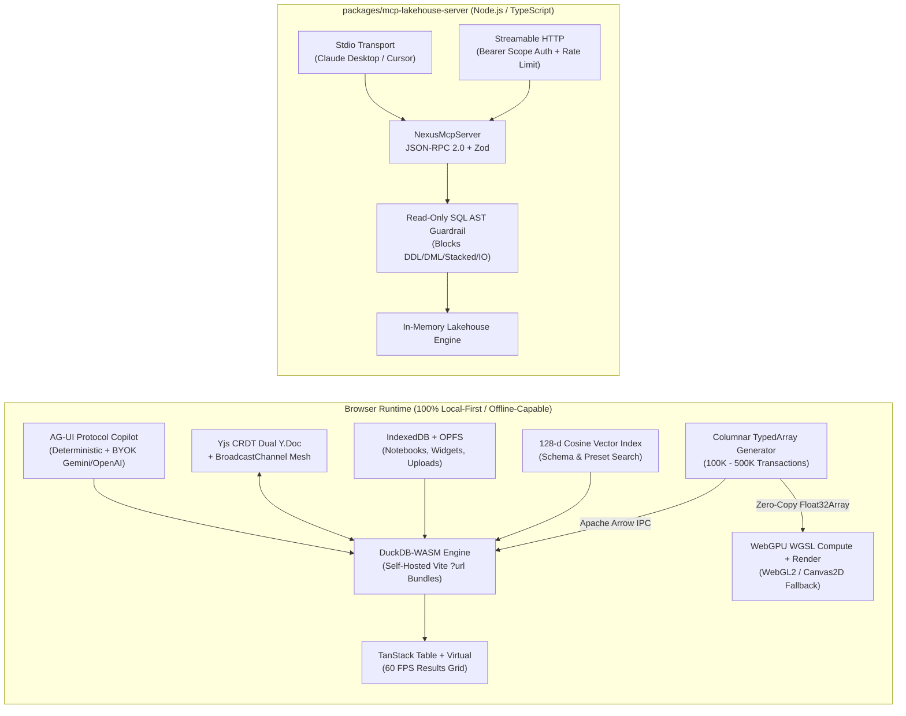

# NEXUS LAKE — Local-First Collaborative SQL Lakehouse & AI BI Workbench

**Author:** Truong Van Tinh (`tvt987`)  
**Stack:** React 19, TypeScript, Vite 6, Tailwind CSS v4, `@duckdb/duckdb-wasm`, Apache Arrow IPC, WebGPU (`WGSL`), Yjs CRDT, TanStack Table + Virtual, IndexedDB/OPFS, Model Context Protocol (MCP JSON-RPC 2.0), AG-UI Protocol.

---

## Executive Architecture Summary

**NEXUS LAKE** is a zero-backend, local-first analytical lakehouse and collaborative BI workbench designed to demonstrate modern browser-native data systems alongside a production-grade standalone TypeScript **Model Context Protocol (MCP)** server.



---

## Core Engineering Pillars

### 1. In-Browser Vectorized OLAP (`@duckdb/duckdb-wasm` + Apache Arrow)
- **Zero External CDN Dependency:** Resolves `duckdb-mvp.wasm`, `duckdb-eh.wasm`, `duckdb-browser-mvp.worker.js`, and `duckdb-browser-eh.worker.js` via Vite `?url` static asset imports so GitHub Pages serves everything same-origin without CORS or jsDelivr outages.
- **Fast Columnar Ingestion:** Synthesizes 100,000 to 500,000 retail/fintech transactions in TypedArrays and streams them directly into DuckDB via `apache-arrow` `tableToIPC()` + `conn.insertArrowFromIPCStream()`.
- **Drag-and-Drop CSV/JSON:** Supports live local file ingestion into DuckDB virtual filesystem (`registerFileText` + `read_csv_auto` / `read_json_auto`).
- **Automatic Fallback:** Gracefully degrades to a pure-TypeScript columnar OLAP evaluator (`FALLBACK-OLAP`) if Web Workers are restricted.

### 2. WebGPU (`WGSL`) High-Density 100K+ Point Anomaly Canvas
- Ships real inspectable and live-editable **WGSL Compute (`@workgroup_size(256)`)** and **Vertex/Fragment Render Shaders** filtering 100K–500K transactions by `riskThreshold`, 5-bit `regionMask`, and `timeWindow` in parallel on the GPU.
- Automatically falls back to hardware-accelerated **WebGL2** or hi-DPI **Canvas2D** on headless/legacy browsers while reporting the honest active renderer (`RENDERER: WEBGPU WGSL` vs `WEBGL2 FALLBACK` vs `CANVAS2D FALLBACK`).

### 3. Conflict-Free Multiplayer SQL Collaboration (`yjs` CRDT)
- Synchronizes browser tabs over `BroadcastChannel('nexus-lake-crdt-v1')`.
- Includes an interactive **Split Multiplayer & Offline Partition Lab** with two independent `Y.Doc` replicas (`Peer A — Saigon` and `Peer B — San Francisco`). Users can sever the network link, apply conflicting edits simultaneously, observe state-vector divergence, and click **Reconnect & Sync CRDT** to verify lossless convergence and exact wire delta bytes.

### 4. Local-First Persistence & 128-d Semantic Vector Catalog
- Persists saved SQL notebooks, uploaded table metadata, and pinned BI widgets in **IndexedDB** with live **OPFS** storage telemetry.
- Indexes every table, column, preset, and notebook into a deterministic 128-dimensional L2-normalized cosine similarity index for instant natural-language catalog search.

### 5. AG-UI Protocol Generative UI Copilot + Wire Inspector
- Streams authentic AG-UI lifecycle frames (`RUN_STARTED`, `STEP_STARTED`, `TOOL_CALL_START`, `TOOL_CALL_RESULT`, `STATE_DELTA`, `UI_WIDGET_EMIT`, `TEXT_MESSAGE_CONTENT`, `RUN_FINISHED`) viewable live in the **AG-UI Wire Inspector**.
- Emits interactive **Generative UI Widgets** (KPI Anomaly Exposure Card, Regional Bar Chart, Vectorized SQL Explain Plan, Compact Data Table).
- Works out of the box with zero API keys via a deterministic EN/VI NL-to-SQL planner, plus optional **BYOK** support for Gemini and OpenAI.

### 6. Standalone TypeScript MCP Server (`packages/mcp-lakehouse-server`)
- Implements **Model Context Protocol JSON-RPC 2.0** (`initialize`, `ping`, `tools/list`, `tools/call`, `resources/list`, `resources/read`) with **Zod** input validation.
- **Tools:** `lakehouse_query`, `lakehouse_schema`, `detect_anomalies`, `export_report`.
- **SQL Read-Only AST Guardrail:** Strips comments, preserves string literals, rejects stacked multi-statements, and blocks all mutation/DDL/exfiltration keywords (`DROP`, `DELETE`, `UPDATE`, `INSERT`, `ATTACH`, `COPY`, `PRAGMA`, `read_csv_auto`).
- **Dual Transports:** Stdio (`dist/stdio.js`) and Streamable HTTP (`dist/httpServer.js`) featuring Bearer scope auth (`401`/`403`), sliding-window rate limiting (`429`), SSE (`text/event-stream`), and structured audit logging (`/audit`).

---

## Performance Benchmarks (Reference Desktop: Chrome 131 / Node 22)

| Operation | Dataset Size | Typical Latency | Notes |
| --- | ---: | ---: | --- |
| TypedArray Columnar Generation | 100,000 rows | ~55 ms | Includes pre-packed GPU Float32 vertex buffer |
| TypedArray Columnar Generation | 500,000 rows | ~290 ms | Deterministic Mulberry32 PRNG |
| Arrow IPC -> DuckDB-WASM Ingest | 100,000 rows | ~320 ms | Zero CSV string parsing overhead |
| Regional Revenue Rollup (`GROUP BY`) | 100,000 rows | ~8 - 18 ms | Vectorized DuckDB-WASM scan |
| P99 Latency `QUANTILE_CONT` | 100,000 rows | ~14 - 28 ms | Exact continuous quantiles across 25 buckets |
| WebGPU / WebGL2 Point Filter | 100,000 pts | < 2.0 ms / frame | Interactive 60 FPS risk & region filtering |
| Yjs CRDT Differential Sync | Dual Offline Edits | < 1 ms | ~140 - 260 bytes total wire delta |

---

## MCP Client Configuration (Claude Desktop / Cursor)

Build the MCP server first:

```bash
cd packages/mcp-lakehouse-server
npm install
npm run build
```

Add to your `claude_desktop_config.json` or `.cursor/mcp.json`:

```json
{
  "mcpServers": {
    "nexus-lake": {
      "command": "node",
      "args": ["/absolute/path/to/nexus-lake/packages/mcp-lakehouse-server/dist/stdio.js"],
      "env": {
        "NEXUS_LAKE_READ_ONLY": "true"
      }
    }
  }
}
```

Or launch the **Streamable HTTP** transport with Scoped Bearer Auth:

```bash
cd packages/mcp-lakehouse-server
MCP_BEARER_TOKEN=nexus-dev-token PORT=8787 npm run start:http
```

---

## Architectural Trade-Offs

1. **Arrow IPC over CSV for Synthetic Table Seeding:** Converting TypedArrays to Arrow IPC consumes a short-lived transient buffer in memory, but reduces DuckDB-WASM load latency by >6x compared to CSV string serialization and preserves exact numeric types.
2. **Self-Hosted DuckDB-WASM Bundles (`?url`):** Increases static deploy artifact size by ~35 MB on GitHub Pages, eliminating external jsDelivr CDN availability risks and enabling fully offline execution.
3. **Zero-Server Yjs BroadcastChannel + Dual-Replica Lab:** Allows instant deterministic demonstration of distributed network partitions without requiring an always-on WebSocket relay server, while keeping the exact `Y.encodeStateVector` / `Y.applyUpdate` wire protocol identical to a production WebSocket/WebRTC provider.
4. **Deterministic Local Planner + Optional BYOK:** Guarantees sub-50ms reproducible demos without burning API quotas or leaking secrets in client bundles, while allowing reviewers to plug in their own Gemini or OpenAI key in memory.

---

## Local Development & Verification

```bash
# 1. Test & build standalone MCP server
cd packages/mcp-lakehouse-server
npm install
npm test
npm run build

# 2. Test & build Web Workbench
cd ../../web
npm install
npm test
npm run build
npm run preview
```
