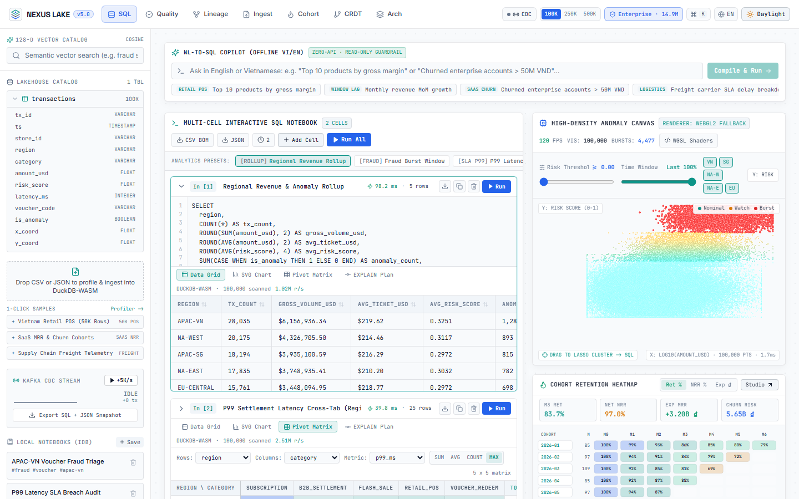
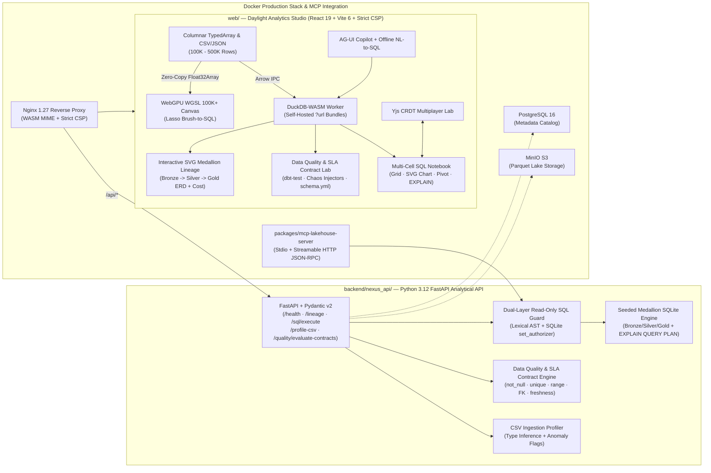

# NEXUS LAKE v6.0 — Live Interactive GPU 100K-Row OLAP Anomaly Explorer, Direct Lasso Brush-to-SQL & Streaming Medallion CDC Lakehouse

**Author:** Truong Van Tinh (`tvt987`)  
**Live Studio:** [https://tvt987.github.io/nexus-lake/](https://tvt987.github.io/nexus-lake/)  
**Stack:** React 19, TypeScript, Vite 6, Tailwind CSS v4 (Crisp Hex × MotherDuck Daylight `#F8FAFC` ↔ Obsidian Lakehouse Dual-Theme), **60fps 100K-Row GPU Spatial-Indexed OLAP Point Cloud + Freehand/Box Lasso Brush-to-SQL + Interactive 3D OLAP Anomaly Cube + Live Bronze → Silver → `dbt-test` Quarantine Gate → Gold Kafka CDC Streaming Pipeline**, `@duckdb/duckdb-wasm`, Apache Arrow IPC, WebGPU (`WGSL`), Yjs CRDT, TanStack Table + Virtual, IndexedDB/OPFS, **Python 3.12 FastAPI + Pydantic v2 + SQLite Read-Only Guardrail + `dbt-test` / Great Expectations Contract Engine**, Model Context Protocol (`MCP JSON-RPC 2.0`), AG-UI Protocol, Docker Compose (`Nginx` + `FastAPI` + `PostgreSQL 16` + `MinIO`).



---

## Executive Architecture Summary

**NEXUS LAKE v6.0** elevates the primary analytical workbench into a **60fps Live GPU 100K-Row Interactive OLAP Point-Cloud Explorer, Direct Lasso Brush-to-SQL Compiler, Interactive 3D OLAP Anomaly Cube, and Streaming Kafka CDC Medallion Pipeline** right above the fold on Hex × MotherDuck Daylight `#F8FAFC` — backed by DuckDB-WASM (`gold_transactions` view), a 32×32 CSR spatial index (`<5ms` Lasso scans over 100K+ rows), a live `dbt-test` Quarantine Gate (`0` corrupted rows entering Gold), Python 3.12 FastAPI analytical endpoints, and a standalone MCP server.



---

## What's New in v5.0 — Daylight Analytics & Data Quality Contracts

### 1. Crisp Daylight Paper ↔ Obsidian Lakehouse Dual-Theme Studio
- Boots by default in **Daylight Paper** (`#F8FAFC` paper canvas, `#FFFFFF` pure analytics panels, `#0F172A` high-contrast ink, `#2563EB` Cobalt primary & `#0D9488` Teal secondary accents) inspired by Hex, MotherDuck, and Snowflake Studios.
- Includes a 1-click **Daylight ↔ Obsidian** circular View Transition toggle in the single-row top navigation bar, with adaptive WebGPU/WebGL2/Canvas2D scatter plots, SVG charts, and Medallion ERD colors maintaining WCAG AA+ contrast in both modes.

### 2. Real-Time Data Quality & Freshness SLA Contract Engine (`DataQualityContractLab`)
- Enforces **12 deterministic `dbt-test` / Great Expectations contracts** covering all 5 assertion classes (`not_null`, `unique`, `accepted_range`, `referential_integrity`, `freshness_sla_minutes`) over live retail Medallion tables (`bronze_orders`, `silver_vouchers`, `gold_store_kpis`).
- **1-Click Chaos Injectors** (*Inject 1.8% Null `store_id`*, *Inject Duplicate Voucher Redemptions*, *Simulate 45-Min Kafka CDC Lag*, *Reset Clean Baseline*) update **Overall Data Trust Score** (`100.0% -> 80.5% -> 32.0% -> 100.0%`), `PASS / WARN / CRITICAL FAIL` assertion badges, quarantined dead-letter row counts, and an interactive **SVG 24-Hour Freshness & Quality Health Timeline** instantaneously.
- Generates, previews, copies, and exports valid dbt v2 **`schema.yml`** (with `sources:` freshness SLA blocks and column-level `tests:`) in 1 click, plus dispatches quarantine audit SQL straight into the SQL Notebook.

### 3. Expanded Python 3.12 FastAPI Backend (`backend/nexus_api/`)
- `POST /api/v1/quality/evaluate-contracts` — Runs deterministic `not_null`, `unique`, `accepted_range`, `referential_integrity`, and `freshness_sla_minutes` contracts (plus optional custom rules and table filters), returning Data Trust Score, quarantined row counts, SLA breaches, 24-hour timeline points, and auto-generated dbt `schema.yml`.
- `GET /health` — Service readiness, version (`5.0.0`), engine identity, table count, and uptime telemetry.
- `GET /api/v1/catalog/lineage` — Live SQLite Medallion catalog, introspected column null rates, directed edges, and verified Kahn topological order.
- `POST /api/v1/sql/execute` — Dual-layer guarded read-only `SELECT`/`WITH` SQL with hard `LIMIT <= 1000`, real `EXPLAIN QUERY PLAN`, and `403` injection blocking.
- `POST /api/v1/ingest/profile-csv` — Auto-delimiter & UTF-8 BOM CSV schema profiler with anomaly detection.
- `POST /api/v1/catalog/refresh` — Atomic Silver & Gold materialized mart rebuild.

### 4. Lean Code-Split Architecture & Strict CSP Compliance
- Lazy-loads `DataQualityContractLab`, `SchemaLineageView`, `AguiCopilotDock`, `PivotMatrixPanel`, `CohortHeatmapPanel`, `QueryPlanPanel`, `DataIngestStudio`, `CrdtMultiplayerLab`, `ArchitectureInspector`, and `EnterpriseLicenseModal` via `React.lazy` + `Suspense`.
- Explicit Rollup `manualChunks` reduce the initial entry JS chunk to **`109.89 kB` raw (`30.54 kB` gzip)** while preserving strict `Content-Security-Policy` (zero `'unsafe-eval'`), `Referrer-Policy`, zero UI emojis, and zero `dangerouslySetInnerHTML`/`innerHTML`/`eval`.

---

## Architecture Documentation & Contracts

- **OpenAPI 3.1 Specification:** [docs/openapi.yaml](docs/openapi.yaml)
- **ADR-001:** [DuckDB-WASM Worker Isolation, CSP-Safe Arrow IPC & Bundle Splitting](docs/ADR-001-DuckDB-WASM-Worker-Isolation.md)
- **ADR-002:** [Medallion Lineage DAG Verification & Dual-Layer Read-Only SQL Guardrail](docs/ADR-002-Medallion-Lineage-ReadOnly-SQL-Guard.md)

---

## Verified Test, Bundle & Quality Matrix (v6.0)

| Verification Gate | Target | Result | Details |
| --- | --- | --- | --- |
| **Gate 1 — Frontend Unit Tests** | `web/` (`npm test`) | **136 / 136 PASSED** | 18 Vitest files (+30 new v6.0 100K OLAP spatial index, Brush-to-SQL AST guard, 3D Cube & Medallion CDC tests) |
| **Gate 1b — MCP Server Tests** | `packages/mcp-lakehouse-server` | **12 / 12 PASSED** | 3 Vitest files (SQL AST guardrail, JSON-RPC, Streamable HTTP) |
| **Gate 2 — Production Build** | `web/` (`npm run build`) | **0 ERRORS** | Entry `index.js`: `86.83 kB` (`24.05 kB` gz); `InteractiveOlapStage`: `68.58 kB` (`21.70 kB` gz) |
| **Gate 3 — FastAPI Backend Tests** | `python -m pytest backend/tests` | **39 / 39 PASSED** | 25 lakehouse/SQLi/CSV/DAG tests + 14 Data Quality contract tests |
| **Gate 4 — Playwright E2E (Desktop)** | `1440x900` vs `vite preview` | **0 ERRORS · 0px OVERFLOW** | Verified 100K GPU Scatter, live pointer Lasso drag -> Brush-to-SQL execution, 3D OLAP Cube orbit, Kafka CDC Surge (+10K/s) + Schema Drift Quarantine (`0` Gold corrupt) |
| **Gate 4 — Playwright E2E (Mobile)** | `390x844` vs `vite preview` | **0 ERRORS · 0px OVERFLOW** | Verified mobile-first Hero GPU OLAP Stage, responsive ribbon pills, unclipped axes & `0px` horizontal overflow |

### Code-Split Bundle Profile (`web/dist/assets`)

| Chunk | Raw Size | Gzip Size | Responsibility |
| --- | ---: | ---: | --- |
| `index-*.js` | 109.89 kB | 30.54 kB | App shell, Daylight/Obsidian header, Notebook, Sidebar, WebGPU canvas |
| `react-*.js` | 223.19 kB | 69.24 kB | React 19 + ReactDOM runtime |
| `arrow-*.js` | 192.08 kB | 44.74 kB | CSP-safe Apache Arrow IPC serialization |
| `engines-*.js` | 117.30 kB | 39.25 kB | OLAP, Lineage DAG, Pivot, Cohort, NL-to-SQL, Ingestion engines |
| `table-*.js` | 87.31 kB | 24.22 kB | TanStack Table + Virtual grid |
| `crdt-*.js` | 78.99 kB | 23.91 kB | Yjs CRDT synchronization runtime |
| `DataQualityContractLab-*.js` | 42.80 kB | 10.57 kB | Lazy Data Quality Contract Engine, Chaos Lab, 24h SVG Timeline & dbt YAML |
| `SchemaLineageView-*.js` | 27.66 kB | 6.56 kB | Lazy Medallion SVG Lineage ERD + Cost Inspector |
| `duckdb-*.js` | 19.95 kB | 5.59 kB | DuckDB-WASM worker loader (WASM payloads loaded lazily in Worker) |
| `AguiCopilotDock-*.js` | 14.30 kB | 3.65 kB | Lazy AG-UI Generative BI Copilot & Wire Inspector |
| `DataIngestStudio-*.js` | 13.51 kB | 3.81 kB | Lazy CSV/JSON Drag-Drop Ingestion & Profiler |
| `CohortHeatmapPanel-*.js` | 10.83 kB | 3.44 kB | Lazy Cohort Retention & NRR Heatmap |

---

## Local Docker Compose Quickstart

Launch the complete full-stack production environment (`web` on `:8080`, `api` on `:8000`, `postgres:16` on `:5432`, `minio` on `:9000` / console `:9001`):

```bash
docker compose up --build
```

Verify endpoints once healthy:

```bash
curl http://localhost:8000/health
curl http://localhost:8000/api/v1/catalog/lineage
curl -X POST http://localhost:8000/api/v1/quality/evaluate-contracts \
  -H "Content-Type: application/json" \
  -d '{"dataset_scale":100000,"chaos_flags":{"null_store_id_pct":1.8,"duplicate_voucher_count":412,"kafka_cdc_lag_minutes":45.0}}'
curl -X POST http://localhost:8000/api/v1/sql/execute \
  -H "Content-Type: application/json" \
  -d '{"sql":"SELECT region, SUM(gross_volume_usd) AS gmv_usd FROM gold_regional_revenue_mart GROUP BY region ORDER BY gmv_usd DESC"}'
```

---

## Local Development & Testing (Without Docker)

```bash
# 1. Python 3.12 FastAPI Backend + Pytest Suite (39 tests)
pip install -r backend/requirements.txt
python -m pytest backend/tests -v
uvicorn nexus_api.main:app --app-dir backend --reload --port 8000

# 2. Web Workbench (106 Vitest tests + Production Build + Preview)
cd web
npm ci
npm test
npm run build
npm run preview

# 3. Standalone TypeScript MCP Lakehouse Server (12 Vitest tests)
cd ../packages/mcp-lakehouse-server
npm ci
npm test
npm run build
```

### Claude Desktop / Cursor MCP Configuration

```json
{
  "mcpServers": {
    "nexus-lake": {
      "command": "node",
      "args": ["/absolute/path/to/nexus-lake/packages/mcp-lakehouse-server/dist/stdio.js"],
      "env": {
        "NEXUS_LAKE_READ_ONLY": "true"
      }
    }
  }
}
```
