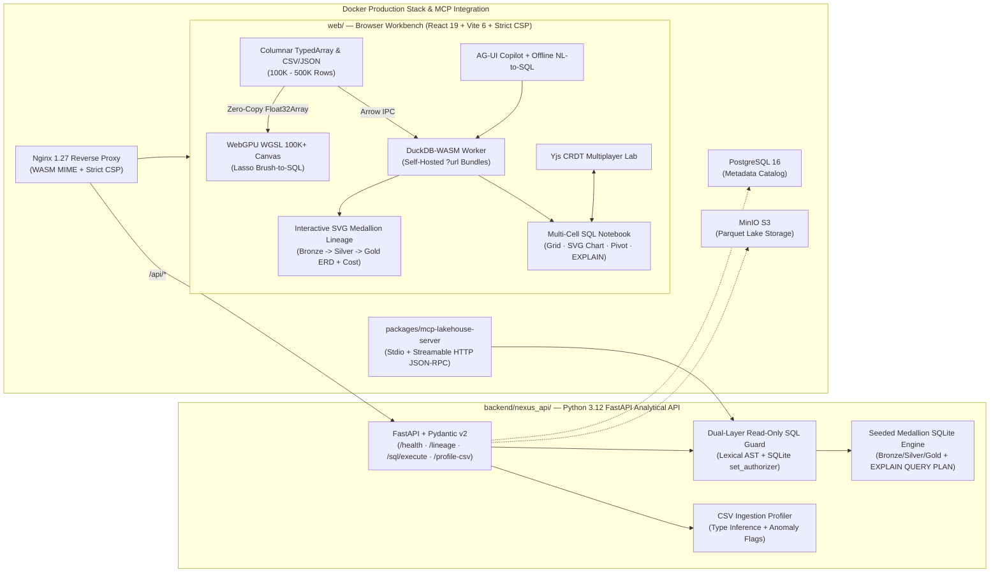

# NEXUS LAKE v4.0 — Full-Stack FastAPI + DuckDB-WASM Analytics Lakehouse Monorepo

**Author:** Truong Van Tinh (`tvt987`)  
**Stack:** React 19, TypeScript, Vite 6, Tailwind CSS v4, `@duckdb/duckdb-wasm`, Apache Arrow IPC, WebGPU (`WGSL`), Yjs CRDT, TanStack Table + Virtual, IndexedDB/OPFS, **Python 3.12 FastAPI + Pydantic v2 + SQLite Read-Only Guardrail**, Model Context Protocol (`MCP JSON-RPC 2.0`), AG-UI Protocol, Docker Compose (`Nginx` + `FastAPI` + `PostgreSQL 16` + `MinIO`).

---

## Executive Architecture Summary

**NEXUS LAKE v4.0** is a full-stack analytical lakehouse monorepo combining a local-first browser OLAP workbench (`DuckDB-WASM` + `WebGPU` + interactive `Medallion Schema Lineage ERD` + multi-cell SQL Notebook) with a tested **Python 3.12 FastAPI** read-only SQLite analytical API and a standalone TypeScript **Model Context Protocol (MCP)** server.



---

## What's New in v4.0 Full-Stack Monorepo

### 1. Interactive SVG Medallion Data Lineage & Schema ERD (`SchemaLineageView`)
- Visualizes the full **Bronze Raw -> Silver Cleaned -> Gold KPI Marts** lakehouse topology with clickable SVG table cards showing PK/FK column schemas, live row counts, storage MB, and null-rate data quality grades (`A`/`B`/`C`).
- Clicking any table card runs $O(|V|+|E|)$ BFS traversal to highlight **animated upstream ancestors (cyan)** and **downstream impact paths (signal orange)** while dimming unrelated branches.
- Dynamically mounts user-uploaded CSV/JSON schemas into Bronze and enforces cycle-free DAG integrity via **Kahn's topological sort**.

### 2. Materialized View Refresh & Query Plan Cost Inspector
- Inspects **Estimated Scan Rows**, **Partition Pruning Ratio (%)**, **Memory Footprint (MB)**, and **Estimated Latency (ms)** for both partitioned predicate pushdowns and full table scans, alongside actionable optimizer recommendations.
- Simulates **1-click incremental refreshes** across `Bronze -> Silver -> Gold` in strict topological order (or scoped to a selected lineage chain), updating freshness telemetry and logging per-stage delta rows, pruning ratio, memory MB, and latency.

### 3. Tested Python 3.12 FastAPI Lakehouse Backend (`backend/nexus_api/`)
- `GET /health` — Service readiness, engine identity, table count, and uptime telemetry.
- `GET /api/v1/catalog/lineage` — Live SQLite Medallion catalog (`bronze_pos_events`, `bronze_saas_subscriptions`, `silver_transactions_clean`, `silver_customer_accounts`, `gold_regional_revenue_mart`, `gold_nrr_cohort_mart`), introspected column null rates, directed edges, and verified Kahn topological order.
- `POST /api/v1/sql/execute` — Executes guarded read-only `SELECT`/`WITH` SQL with hard `LIMIT` cap (`<= 1000`), real `EXPLAIN QUERY PLAN`, and cost estimates. Blocks `DROP`, `DELETE`, `UPDATE`, `INSERT`, `ALTER`, `ATTACH`, `PRAGMA`, and stacked SQL injections with HTTP `403` via both lexical AST auditing and SQLite C-level `set_authorizer`.
- `POST /api/v1/ingest/profile-csv` — Auto-detects delimiters, strips UTF-8 BOM, infers `integer`/`float`/`boolean`/`date`/`string`, computes `min`/`max`/`mean`/`distinct_count`/`null_rate_pct`, and flags `HIGH_NULL_RATE`, `CONSTANT_COLUMN`, `NUMERIC_OUTLIERS`, `MIXED_TYPE_VALUES`, and `DUPLICATE_ROWS`.
- `POST /api/v1/catalog/refresh` — Atomically rebuilds Silver and Gold materialized marts from Bronze tables.

### 4. Route/Panel Code Splitting & Strict CSP Compliance
- Lazy-loads heavy workspaces and cell views (`SchemaLineageView`, `PivotMatrixPanel`, `CohortHeatmapPanel`, `QueryPlanPanel`, `DataIngestStudio`, `CrdtMultiplayerLab`, `ArchitectureInspector`, `EnterpriseLicenseModal`) with `React.lazy` + `Suspense`.
- Explicit Rollup `manualChunks` (`react`, `duckdb`, `arrow`, `table`, `crdt`, `icons`, `engines`) keep the entry JS lean (`121.7 kB` raw / `32.8 kB` gzip).
- Preserves strict `Content-Security-Policy` (zero `'unsafe-eval'`), `Referrer-Policy`, zero UI emojis, and zero `dangerouslySetInnerHTML`/`innerHTML`/`eval`.

---

## Architecture Documentation & Contracts

- **OpenAPI 3.1 Specification:** [docs/openapi.yaml](docs/openapi.yaml)
- **ADR-001:** [DuckDB-WASM Worker Isolation, CSP-Safe Arrow IPC & Bundle Splitting](docs/ADR-001-DuckDB-WASM-Worker-Isolation.md)
- **ADR-002:** [Medallion Lineage DAG Verification & Dual-Layer Read-Only SQL Guardrail](docs/ADR-002-Medallion-Lineage-ReadOnly-SQL-Guard.md)

---

## Verified Test, Bundle & Quality Matrix

| Verification Gate | Target | Result | Details |
| --- | --- | --- | --- |
| **Gate 1 — Frontend Unit Tests** | `web/` (`npm test`) | **84 / 84 PASSED** | 16 Vitest files (+19 new v4.0 lineage, DAG & cost tests) |
| **Gate 1b — MCP Server Tests** | `packages/mcp-lakehouse-server` | **12 / 12 PASSED** | 3 Vitest files (SQL AST guardrail, JSON-RPC, Streamable HTTP) |
| **Gate 2 — Production Build** | `web/` (`npm run build`) | **0 ERRORS** | Entry `index.js`: `121.7 kB` (`32.8 kB` gz); `SchemaLineageView`: `27.4 kB` (`6.6 kB` gz) |
| **Gate 3 — FastAPI Backend Tests** | `python -m pytest backend/tests` | **25 / 25 PASSED** | Real SQLite `SELECT`/`GROUP BY`/CTE, `403` SQLi blocks, CSV profiler, DAG check |
| **Gate 4 — Playwright E2E (Desktop)** | `1440x900` vs `vite preview` | **0 ERRORS · 0px OVERFLOW** | Verified SQL Notebook, Pivot, EXPLAIN Cost, Lineage SVG clicks, Refresh, Cohorts |
| **Gate 4 — Playwright E2E (Mobile)** | `390x844` vs `vite preview` | **0 ERRORS · 0px OVERFLOW** | Verified responsive navigation & zero overflow across all 6 workspace tabs |

### Code-Split Bundle Profile (`web/dist/assets`)

| Chunk | Raw Size | Gzip Size | Responsibility |
| --- | ---: | ---: | --- |
| `index-*.js` | 121.73 kB | 32.76 kB | App shell, Notebook toolbar, Sidebar, WebGPU canvas |
| `react-*.js` | 223.19 kB | 69.24 kB | React 19 + ReactDOM runtime |
| `arrow-*.js` | 192.08 kB | 44.74 kB | CSP-safe Apache Arrow IPC serialization |
| `engines-*.js` | 117.31 kB | 39.19 kB | OLAP, Lineage DAG, Pivot, Cohort, NL-to-SQL, Ingestion engines |
| `table-*.js` | 87.31 kB | 24.22 kB | TanStack Table + Virtual grid |
| `crdt-*.js` | 78.99 kB | 23.91 kB | Yjs CRDT synchronization runtime |
| `duckdb-*.js` | 19.95 kB | 5.59 kB | DuckDB-WASM worker loader (WASM payloads loaded lazily in Worker) |
| `SchemaLineageView-*.js` | 27.36 kB | 6.57 kB | Lazy Medallion SVG Lineage ERD + Cost Inspector |
| `CohortHeatmapPanel-*.js` | 10.83 kB | 3.43 kB | Lazy Cohort Retention & NRR Heatmap |
| `EnterpriseLicenseModal-*.js` | 9.05 kB | 3.08 kB | Lazy Commissioning Modal |
| `PivotMatrixPanel-*.js` | 6.96 kB | 2.11 kB | Lazy Cross-Tab Pivot Matrix |

---

## Local Docker Compose Quickstart

Launch the complete full-stack production environment (`web` on `:8080`, `api` on `:8000`, `postgres:16` on `:5432`, `minio` on `:9000` / console `:9001`):

```bash
docker compose up --build
```

Verify endpoints once healthy:

```bash
curl http://localhost:8000/health
curl http://localhost:8000/api/v1/catalog/lineage
curl -X POST http://localhost:8000/api/v1/sql/execute \
  -H "Content-Type: application/json" \
  -d '{"sql":"SELECT region, SUM(gross_volume_usd) AS gmv_usd FROM gold_regional_revenue_mart GROUP BY region ORDER BY gmv_usd DESC"}'
```

---

## Local Development & Testing (Without Docker)

```bash
# 1. Python 3.12 FastAPI Backend + Pytest Suite
pip install -r backend/requirements.txt
python -m pytest backend/tests -v
uvicorn nexus_api.main:app --app-dir backend --reload --port 8000

# 2. Web Workbench (Vitest + Production Build + Preview)
cd web
npm ci
npm test
npm run build
npm run preview

# 3. Standalone TypeScript MCP Lakehouse Server
cd ../packages/mcp-lakehouse-server
npm ci
npm test
npm run build
```

### Claude Desktop / Cursor MCP Configuration

```json
{
  "mcpServers": {
    "nexus-lake": {
      "command": "node",
      "args": ["/absolute/path/to/nexus-lake/packages/mcp-lakehouse-server/dist/stdio.js"],
      "env": {
        "NEXUS_LAKE_READ_ONLY": "true"
      }
    }
  }
}
```
